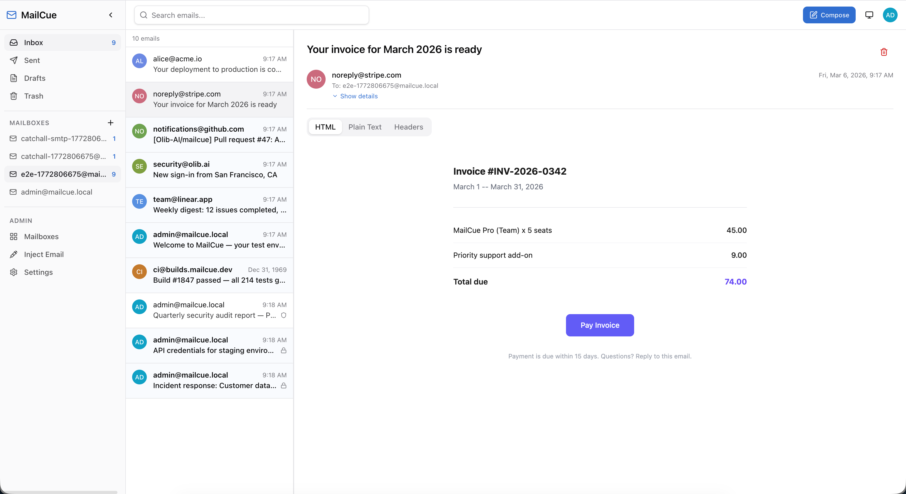
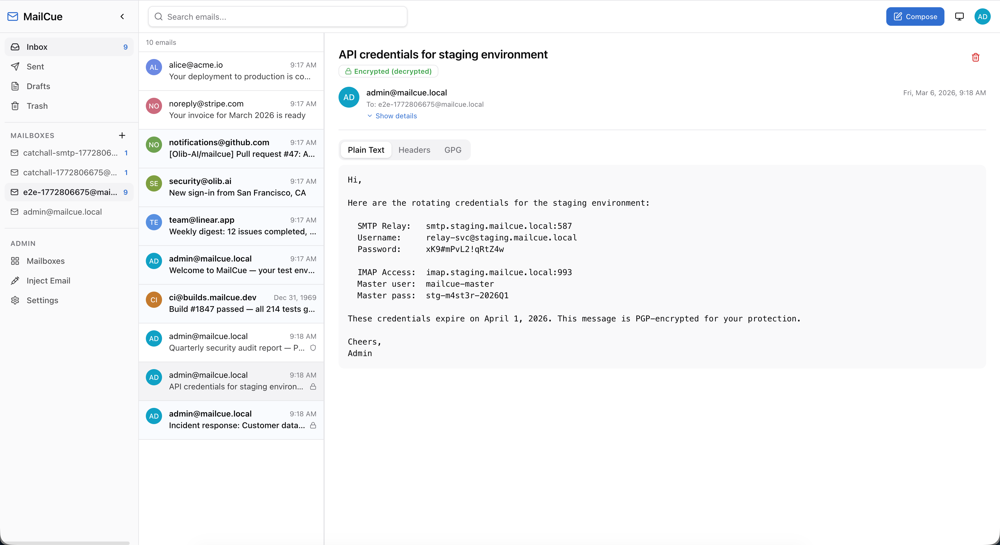
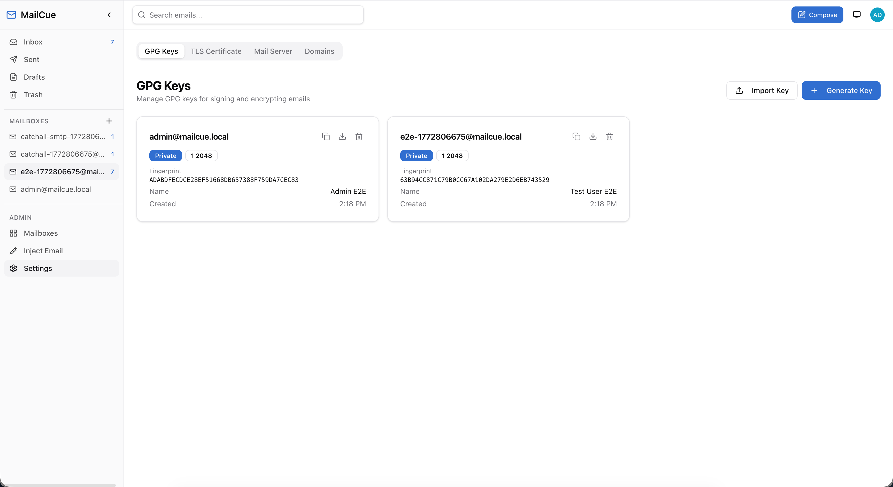

<p align="center">
  <br />
  
  <br />
  <em>A realistic email testing server in a single Docker container.</em>
  <br /><br />
  <a href="https://github.com/Olib-AI/mailcue/actions"></a>
  <a href="https://github.com/Olib-AI/mailcue/blob/main/LICENSE"></a>
  <a href="https://github.com/Olib-AI/mailcue/pkgs/container/mailcue"></a>
  <a href="https://github.com/Olib-AI/mailcue/stargazers"></a>
  <a href="https://github.com/Olib-AI/mailcue/releases"></a>
  <a href="https://www.olib.ai"></a>
  <br />
  <a href="https://github.com/Olib-AI/mailcue/blob/main/openapi.json"></a>
  <a href="https://github.com/Olib-AI/mailcue/blob/main/postman_collection.json"></a>
</p>

---

MailCue packages Postfix, Dovecot, OpenDKIM, OpenDMARC, SpamAssassin, a FastAPI REST API, and a React web UI into one Docker container managed by s6-overlay. It runs a full mail stack with IMAP/POP3 access, DKIM signing, DMARC verification, spam filtering, TLS, and GPG encryption, so you can test email the way it behaves in production. Set `MAILCUE_MODE=production` and the same container runs as a real mail server.

**[Features](#features)** · **[Quick start](#quick-start)** · **[Documentation](#documentation)** · **[Contributing](#contributing)**

<p align="center">
  
</p>
<p align="center">
  
</p>
<p align="center">
  
</p>

## Features

| Capability | What it does |
|---|---|
| Catch-all SMTP | Accepts mail for any address on any domain. Nothing leaves the container. |
| IMAP and POP3 | Read captured mail with any standard client over STARTTLS or implicit TLS. |
| Web UI | React app with a mailbox sidebar, folder navigation, an email viewer, and a compose dialog. |
| REST API and SDKs | JSON API for sending, receiving, injecting, searching, and deleting email, with Python and Node SDKs. |
| Email injection | Insert messages straight into a mailbox over IMAP APPEND for deterministic test setup, with realistic headers. |
| Deliverability testing | Create a scoring mailbox with authentication, SpamAssassin, content, header, and transport diagnostics through the web UI, REST API, Node SDK, and MCP. |
| DKIM, DMARC, SPF | OpenDKIM signing, OpenDMARC verification, and SPF policy checks, with Authentication-Results headers. |
| Spam filtering | SpamAssassin scores inbound mail with a configurable threshold, Bayesian filtering, and RBL checks. |
| TLS everywhere | Auto-generated certificates for SMTP STARTTLS, IMAPS, and POP3S. Upload your own from the UI. |
| GPG / PGP-MIME | Per-mailbox GPG keys. Sign, encrypt, verify, and decrypt mail (RFC 3156). Publish keys to keys.openpgp.org. |
| Real-time events | A Server-Sent Events stream pushes email.received, email.deleted, mailbox.created, and more. |
| Scoped API keys | X-API-Key auth with per-key scopes (read, send, delete, and more) and an optional mailbox allow-list. |
| MCP server | An official Model Context Protocol server gives an AI agent its own mailbox. |
| Domain management | Add custom domains with automatic DKIM and a DNS dashboard for MX, SPF, DKIM, DMARC, MTA-STS, and TLS-RPT. |
| Multi-user | Per-user mailbox quotas and isolated mailboxes, emails, GPG keys, and API keys. |
| Production mode | A hardened mail server with strict domains, required TLS, DMARC reject, and Let's Encrypt certificates. |
| Provider sandbox | Capture outbound SMS, voice, and chat API traffic with wire-identical endpoints and signed webhooks. |
| Flexible database | Zero-config SQLite with optional AES-256 encryption, or external PostgreSQL for concurrent production workloads. |

## Quick start

### Docker Compose

```bash
git clone https://github.com/Olib-AI/mailcue.git
cd mailcue
docker compose up -d
```

Open **http://localhost:8088** and log in with username `admin` and password `mailcue`.

### Docker run

```bash
docker run -d \
  --name mailcue \
  -p 8088:80 \
  -p 25:25 \
  -p 587:587 \
  -p 143:143 \
  -p 993:993 \
  -v mailcue-data:/var/mail/vhosts \
  -v mailcue-db:/var/lib/mailcue \
  -e MAILCUE_DOMAIN=mailcue.local \
  -e MAILCUE_ADMIN_PASSWORD=mailcue \
  ghcr.io/olib-ai/mailcue
```

### Check it works

```bash
curl http://localhost:8088/api/v1/health
```

### Hardened container deployment

MailCue supports fully hardened container execution with a read-only root filesystem, dropped capabilities, no-new-privileges, and non-root services.

```yaml
services:
  mailcue:
    image: ghcr.io/olib-ai/mailcue:2.4.0
    container_name: mailcue
    hostname: mail.example.com
    restart: unless-stopped
    read_only: true
    security_opt:
      - no-new-privileges:true
    cap_drop:
      - ALL
    cap_add:
      - NET_BIND_SERVICE
      - CHOWN
      - DAC_OVERRIDE
      - SETUID
      - SETGID
      - FOWNER
      - SYS_CHROOT
    tmpfs:
      - /tmp:mode=1777
      - /run:exec,mode=755
      - /var/run:exec,mode=755
      - /var/log:mode=755
      - /var/spool/postfix:mode=755
      - /var/lib/postfix:mode=700
      - /var/lib/dovecot:mode=755
      - /var/lib/spamassassin:mode=755
      - /etc/postfix:mode=755
      - /etc/dovecot:mode=755
      - /etc/opendkim:mode=750
      - /etc/opendmarc:mode=755
      - /etc/nginx/conf.d:mode=755
    ports:
      - "80:80"
      - "443:443"
      - "25:25"
      - "465:465"
      - "587:587"
      - "993:993"
      - "995:995"
    environment:
      - MAILCUE_MODE=production
      - MAILCUE_DOMAIN=example.com
      - MAILCUE_HOSTNAME=mail.example.com
      - MAILCUE_ADMIN_PASSWORD=CHANGE_ME_STRONG_PASSWORD
      - MAILCUE_SECRET_KEY=CHANGE_ME_GENERATE_WITH_OPENSSL_RAND
      - MAILCUE_IMAP_MASTER_PASSWORD=CHANGE_ME_GENERATE_ANOTHER_RANDOM_SECRET
    volumes:
      - mailcue-data:/var/mail/vhosts
      - mailcue-db:/var/lib/mailcue
      - mailcue-tls:/etc/ssl/mailcue
      - dkim-data:/etc/opendkim/keys
      - letsencrypt-data:/etc/letsencrypt
    healthcheck:
      test: ["CMD-SHELL", "curl -sf http://127.0.0.1:80/api/v1/health || exit 1"]
      interval: 30s
      timeout: 10s
      retries: 3
      start_period: 30s

volumes:
  mailcue-data:
  mailcue-db:
  mailcue-tls:
  dkim-data:
  letsencrypt-data:
```

### Database choices

MailCue uses SQLite by default, which keeps local and small deployments simple.
Production installations with concurrent API, provider sandbox, HTTP-bin, or
email warmup traffic should use PostgreSQL. MailCue supports a managed
PostgreSQL database or a PostgreSQL container on the same private Docker
network. Connection pooling, production indexes, foreign keys, automatic schema
migrations, and an offline SQLite-to-PostgreSQL migration command are included.

See [Production deployment](docs/guides/production.md#postgresql-for-production)
for Docker Compose examples and the migration procedure. See
[Configuration](docs/guides/configuration.md#database-configuration) for every
database environment variable.

## Documentation

> 📖 Read the full, interactive guides on the **[Official MailCue Documentation Website](https://olib-ai.github.io/mailcue/)**.

| Guide | Covers |
|---|---|
| [Architecture](docs/guides/architecture.md) | Container layout, request flow, and tech stack. |
| [Configuration](docs/guides/configuration.md) | Environment variables and exposed ports. |
| [API reference](docs/guides/api.md) | REST endpoints, authentication, and API key scopes. |
| [Production deployment](docs/guides/production.md) | Hardened mode, PostgreSQL deployment and migration, DNS records, and TLS certificates. |
| [Email clients and TLS trust](docs/guides/clients.md) | IMAP/POP3/SMTP setup and trusting the CA. |
| [Using in CI/CD](docs/guides/ci.md) | Pipeline setup and platform examples. |
| [MCP server](docs/guides/mcp.md) | Give an AI agent its own mailbox over MCP. |
| [Provider sandbox and HTTP bin](docs/guides/sandbox.md) | Capture SMS, voice, and chat traffic, and inspect HTTP requests. |
| [Sharing MailCue across projects](docs/guides/networking.md) | Run one container behind a shared Docker network. |
| [Development and contributing](docs/guides/development.md) | Local setup, linting, tests, and the PR process. |

The API is also served as interactive Swagger UI at `/api/docs`, with machine-readable specs in [openapi.json](openapi.json) and [postman_collection.json](postman_collection.json). See the [deliverability testing guide](docs/guides/deliverability.md) for scoring, visual testing, placement, providers, schedules, and CI policies.

The SDKs and MCP server have their own docs: [Python SDK](sdks/python/README.md), [Node SDK](sdks/node/README.md), and [MCP server](sdks/mcp-node/README.md).

## Contributing

Contributions are welcome. See [Development and contributing](docs/guides/development.md) for local setup, linting, type checks, tests, and the pull request process.

## License

MIT. See [LICENSE](LICENSE).

## Star History

<a href="https://star-history.com/#Olib-AI/mailcue&Date">
 <picture>
   <source media="(prefers-color-scheme: dark)" srcset="https://api.star-history.com/svg?repos=Olib-AI/mailcue&type=Date&theme=dark" />
   <source media="(prefers-color-scheme: light)" srcset="https://api.star-history.com/svg?repos=Olib-AI/mailcue&type=Date" />
   
 </picture>
</a>

## Links

- **Olib AI**: [www.olib.ai](https://www.olib.ai)
- **GitHub**: [github.com/Olib-AI/mailcue](https://github.com/Olib-AI/mailcue)
- **Container registry**: [ghcr.io/olib-ai/mailcue](https://github.com/Olib-AI/mailcue/pkgs/container/mailcue)
- **API docs**: available at `/api/docs` when running
- **Issues**: [github.com/Olib-AI/mailcue/issues](https://github.com/Olib-AI/mailcue/issues)
- **Discussions**: [github.com/Olib-AI/mailcue/discussions](https://github.com/Olib-AI/mailcue/discussions)

---

<p align="center">
  If you find MailCue useful, please consider giving it a <a href="https://github.com/Olib-AI/mailcue">star on GitHub</a>. It helps others discover the project.
</p>

<p align="center">
  Built by <a href="https://www.olib.ai">Olib AI</a>
</p>
